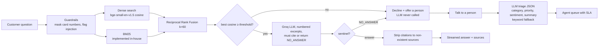

# SupportGPT

An AI support desk that answers from a help center **with the source of every claim attached**, refuses to guess when the
help center doesn't cover a question, and hands those conversations to a human agent already triaged.

**Live:** [support-gpt.vercel.app](https://support-gpt.vercel.app) (frontend, Vercel) · API on Hugging Face Spaces
([`/api/docs`](https://support-gpt.vercel.app/api/docs)). The demo answers for **Fieldnote**, a fictional note-taking app.
Try it as a customer (sign up) or open the agent console with one click (no password).

> The free Space sleeps when idle; the first request can take up to a minute. The demo database is SQLite on the Space's
> ephemeral disk, so accounts and tickets reset when it restarts (seed data and the quality evaluation are rebuilt on boot).

---

## What it does

| Customer | Agent | Admin |
| --- | --- | --- |
| Asks questions in a streaming chat. Each sentence cites a numbered source; hovering a citation draws a line to the passage it came from. | Works a queue sorted by response deadline (SLA by priority). Each ticket arrives with a model-written summary, category, priority and sentiment. | Uploads PDF / Markdown / text into the knowledge base; removes documents; sees how each was chunked. |
| Gets "this isn't in the help center" instead of a guess when retrieval confidence is low, with one click to a person. | Generates a reply draft grounded in the same help-center passages; edits it; marks it as AI-assisted. Internal notes are never shown to customers. | Promotes users to agents, deactivates accounts, reads the audit log. |
| Rates answers, follows tickets, rates resolved tickets (CSAT). | Retrieval inspector: the same query through vectors, BM25 and the fused ranking, side by side. | Runs the retrieval/refusal evaluation and picks the refusal threshold from the sweep. |

## How a question is answered



* **Chunking** splits on headings first (a chunk never mixes two sections), packs paragraphs to ~900 chars with a
  one-paragraph overlap, and embeds `"Doc title > Section\ncontent"` so short passages stay retrievable.
* **Hybrid retrieval**: vectors catch paraphrases ("get my money back"), BM25 catches exact tokens ("E-402", "Team plan").
  The index is rebuilt in memory only when a `kb_state.version` row changes, so it is consistent across restarts.
* **Two refusal gates**: a retrieval-confidence threshold calibrated on the live sweep (the model is not called at all), and a model-level
  `[[NO_ANSWER]]` sentinel detected while streaming before any text reaches the customer.
* **Model resilience**: a 429/quota error on the primary Groq key retries on the secondary key; a decommissioned model
  falls through to the next configured model; auth errors don't fail over. Which key and model served each answer is
  recorded and shown on the Insights page.

## Evaluation

`backend/app/seed/golden.jsonl` holds 68 hand-written questions: 54 answerable (phrased differently from the articles so
BM25 can't win on copy-paste) and 14 out of scope, including a prompt-injection attempt. The evaluator runs them against
the live index without calling the LLM and reports hit@1/3/5 and MRR for hybrid, dense-only and BM25-only, plus refusal
precision/recall and a threshold sweep. It runs automatically on boot and on demand from **Answer quality**.

**Measured on the live deployment (16 Nov 2026, 47 passages, bge-small-en-v1.5, gpt-oss-120b):**

Retrieval (right article for the 54 answerable questions):

| Ranker | Top 1 | Top 3 | Top 5 | MRR |
| --- | --- | --- | --- | --- |
| Hybrid (RRF, used for answers) | 87.0% | 100% | 100% | 0.932 |
| Vectors only | 90.7% | 98.1% | 98.1% | 0.944 |
| BM25 only | 72.2% | 85.2% | 96.3% | 0.811 |

Hybrid is slightly *worse* than vectors alone at top 1 on this set but is the only ranker that puts the right article
in the top 3 every time, which is what matters when the model reads the top 5. The gap at top 1 comes from plain-RRF
weighting BM25 equally; a weighted fusion is the obvious next experiment, tuned on a separate split rather than this set.

Refusal. With bge-small, best-match cosine has a median of 0.72 for answerable questions and 0.62 for out-of-scope
ones, so a retrieval threshold alone can't separate them: at 0.70 it would wrongly refuse 39% of answerable questions.
The threshold is therefore set to **0.57**, the highest value that wrongly refuses at most 5% on the sweep (1.9%), and
the model's `NO_ANSWER` check does the rest. End-to-end through the real chat endpoint
(`backend/scripts/e2e_answer_check.py`, one run, temperature 0.2):

| | Result |
| --- | --- |
| Out-of-scope questions declined | **14 / 14** (6 by the retrieval gate, 8 by the model), including the prompt-injection attempt |
| Answerable questions wrongly declined | **2 / 54 (3.7%)**: one below the retrieval threshold (0.545), one declined by the model ("yearly price for the individual paid tier") |
| Time to full streamed answer | p50 844 ms, p95 1.14 s (through Vercel to the Space) |
| Retrieval only (embed + search) | p95 107 ms on the free 2-vCPU Space |

These are small hand-written sets on a nine-article help center; treat them as a regression signal, not a benchmark.

## Security

| Area | What is implemented |
| --- | --- |
| Sessions | 15-minute JWT access token and 7-day refresh token, both in `HttpOnly; Secure; SameSite=Lax` cookies. Refresh tokens are stored hashed, rotate on every use, and reuse of a rotated token revokes the whole token family. `token_version` on the user kills outstanding access tokens on password or role change. |
| CSRF | Double-submit token (`sg_csrf` cookie mirrored into `X-CSRF-Token`) on every unsafe request, plus an `Origin` allowlist. The frontend calls the API same-origin through a Vercel rewrite, so no third-party cookies are needed. |
| Passwords | Argon2id (OWASP parameters), length + mixed-character + common-password checks, constant-time verification against a dummy hash for unknown emails, account lock after 8 failures. |
| Authorization | Role checks on every route (customer / agent / admin); customers only see their own conversations and tickets (404, not 403); internal notes are hidden from customers; the demo agent account has no password and can't reach admin routes. |
| Input | Pydantic models with `extra="forbid"` and length caps on every field; uploads sniffed by magic bytes (never trusted extensions), capped at 10 MB, never written to disk, de-duplicated by SHA-256; card numbers (Luhn-valid) masked before storage or prompting. |
| Abuse | Sliding-window rate limits per IP and per account on login, signup, chat, uploads, drafts and evaluation. |
| Headers | API: strict CSP, HSTS, `X-Frame-Options: DENY`, `nosniff`, `no-store`. Site (vercel.json): CSP without inline scripts, HSTS, frame denial, Permissions-Policy. |
| Supply chain | `pip-audit --strict` and `npm audit` in CI, gitleaks secret scan, dependencies pinned, non-root Docker image. `python-jose` (and its unpatched `ecdsa` CVE) replaced with PyJWT. |

## Stack

Backend: Python 3.12, FastAPI, SQLAlchemy 2, Alembic, fastembed (ONNX, no torch), NumPy, Groq, PyJWT, argon2-cffi, pypdf.
Frontend: React 18, TypeScript, Vite, React Router 7, hand-written CSS and SVG icons (no UI kit).
Infra: Docker on Hugging Face Spaces, Vercel, GitHub Actions (lint, 51 tests at 92% coverage, audits, deploy).

## Run locally

```bash
# backend
cd backend
python -m venv ../.venv && source ../.venv/bin/activate   # one shared venv for the repo
pip install -r requirements-dev.txt
cp .env.example .env   # set SECRET_KEY and a Groq key
alembic upgrade head && uvicorn app.main:app --reload --port 8000
pytest -q              # tests use a hash embedder and a fake LLM: no network needed

# frontend (proxies /api to :8000)
cd frontend && npm ci && npm run dev
```

## Deployment

* **Frontend**: Vercel builds `frontend/` (see `vercel.json`) and rewrites `/api/*` to the Space.
* **Backend**: on every push to `main`, CI runs the checks and then syncs `backend/` to the Space with a token scoped to
  that one Space (`HF_TOKEN` secret). Space secrets: `SECRET_KEY`, `GROQ_API_KEY_PRIMARY` (or `GROQ_API_KEY`),
  `GROQ_API_KEY_SECONDARY`, `ADMIN_EMAIL`, `ADMIN_PASSWORD`. Variables: `ALLOWED_ORIGINS`, `DEMO_AGENT_ENABLED`,
  `ABSTAIN_THRESHOLD`.

## Honest limitations

* SQLite on an ephemeral disk: data resets on restart. Swapping `DATABASE_URL` to Postgres works without code changes
  (the driver and URL normalisation are already in place), but the free demo doesn't use one.
* Rate limiting and the retrieval index live in process memory, which is right for one worker and wrong for several;
  the limiter would move to Redis.
* The evaluation measures retrieval and refusal, not answer faithfulness; grading generated answers would need an
  LLM-as-judge or human labels.
* Fieldnote's help center is nine short articles. Retrieval quality on a large, messy knowledge base would be lower and
  the threshold would need re-calibrating.
* The client IP used for rate limiting comes from `X-Forwarded-For` behind two proxies; a caller hitting the Space
  directly can spoof it (per-account limits still apply).

`docs/AUDIT-2026-08.md` is the audit of the previous version that motivated this rewrite.

## License

MIT
